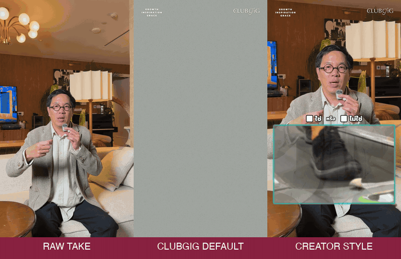
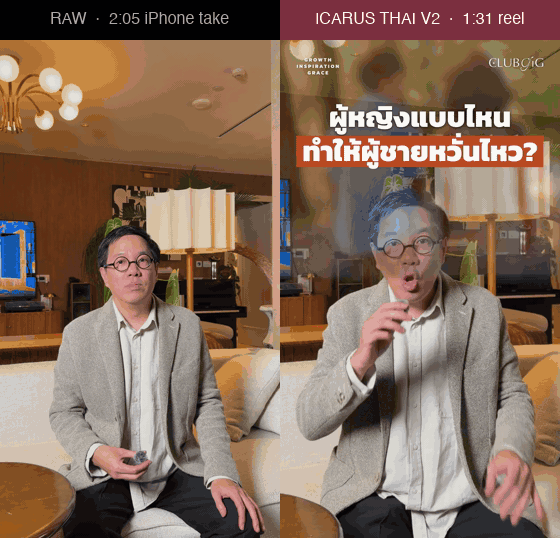
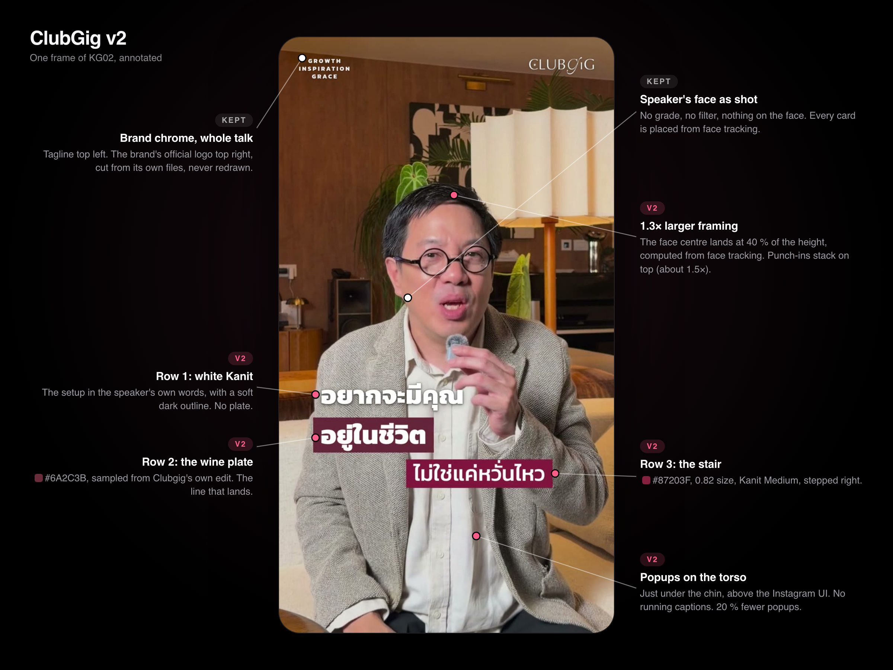
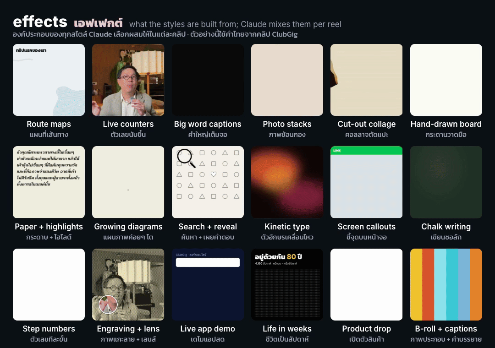
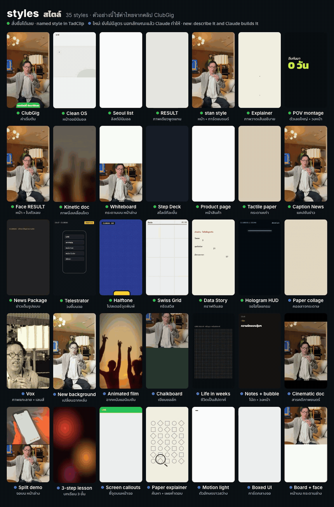
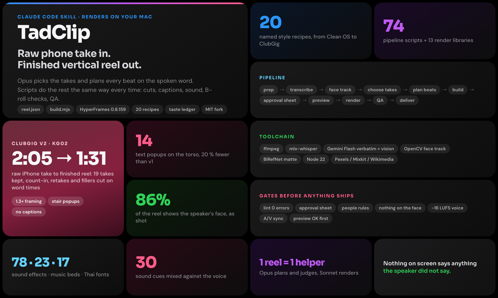

<div align="center">

<h1>TadClip</h1>

<p><b>One raw take in.<br>A finished reel out, in ClubGig or in any creator's style.</b></p>

<p>AI video editor for Thai talking-head reels. A Claude Code skill that renders on your Mac.</p>

[](recipes/clubgig/README.md)
[](recipes/clone/README.md)
[](scripts/HF_VERSION)
[](https://github.com/kurbaitaev/ghost-editor)

</div>

## Quick start · เริ่มใช้งาน

For an Apple silicon Mac, signed in to [Claude Code](https://claude.com/claude-code) (the Claude app) or [Codex](https://github.com/openai/codex). No GitHub account needed. It takes about 30-40 minutes (a few GB to download). If the internet drops, paste the same line again: it picks up where it stopped.

ใช้กับ Mac ชิป Apple (M1 ขึ้นไป) ที่ลง [Claude Code](https://claude.com/claude-code) หรือ [Codex](https://github.com/openai/codex) ไว้แล้ว ไม่ต้องมีบัญชี GitHub ใช้เวลาประมาณ 30-40 นาที ส่วนใหญ่คือรอดาวน์โหลด ถ้าเน็ตหลุดกลางทาง สั่งติดตั้งเดิมอีกครั้งได้ ส่วนที่เสร็จแล้วจะข้ามไปเอง

**1. Install: one line · ติดตั้ง: บรรทัดเดียว**

```bash
curl -fsSL https://raw.githubusercontent.com/npnatt12/tadclip-public/main/install.sh | bash
```

Paste it into Terminal (⌘Space, type Terminal, Enter), or into Claude Code or Codex: they run it for you. It installs everything into your home folder: no Mac password, no Homebrew, no Apple developer tools. Each step prints `== [n/7]`, and a timed log of the whole install is kept in `~/Library/Logs/TadClip/`.

วางบรรทัดนี้ใน Terminal (กด ⌘Space พิมพ์ Terminal แล้วกด Enter) หรือวางใน Claude Code / Codex ให้มันรันให้ก็ได้ ลงทุกอย่างไว้ในโฟลเดอร์ของคุณเอง ไม่ถามรหัสผ่านเครื่อง ไม่ต้องลง Homebrew หรือ developer tools ของ Apple ทุกขั้นจะขึ้นว่า `== [n/7]` และเก็บบันทึกพร้อมเวลาไว้ที่ `~/Library/Logs/TadClip/`

**2. Cut a reel · ตัดคลิป**

When it's done, the TadClip page opens in your browser: choose your clip and press **ตัดต่อให้หน่อย**. Next time, double-click **TadClip** on the Desktop, then **TadClip.app**. It's in Thai, with English, light and dark modes, and a button that reads the screen aloud.

ติดตั้งเสร็จ หน้า TadClip จะเปิดขึ้นในเบราว์เซอร์ เลือกคลิป แล้วกด **ตัดต่อให้หน่อย** ไม่ต้องพิมพ์อะไร ครั้งต่อไป ดับเบิลคลิก **TadClip** บนเดสก์ท็อป แล้วเปิด **TadClip.app**

Prefer the chat? Quit and reopen the Claude app once, start a new chat and say · ชอบสั่งในแชตมากกว่า: ปิดแล้วเปิดแอป Claude ใหม่หนึ่งครั้ง เปิดแชตใหม่ แล้วพิมพ์

> ตัดต่อคลิปนี้ ~/Downloads/my-video.mov

> ตัดต่อคลิปนี้ให้เป็นสไตล์ @creator ให้หน่อย ~/Downloads/my-video.mov

**Something wrong? · มีปัญหา?** Paste the same line again (it skips what's done), or collect the logs for us: `bash ~/.claude/skills/tadclip/scripts/logs.sh` (or tell Claude "เก็บบันทึก TadClip"). Keys are never included.

**Optional: more tailored reels · ไม่บังคับ: อยากให้คลิปตรงใจขึ้น**

TadClip works without any key. To make it more tailored, add two free keys: run `open -e ~/.claude/skills/tadclip/.env` (or ask your agent to "open the TadClip key file"), paste each key after its `=` and press ⌘S. **Paste keys into this file, never into the chat.**

TadClip ใช้ได้เลยโดยไม่ต้องมีคีย์ ถ้าอยากให้คลิปตรงใจขึ้น ใส่คีย์ฟรี 2 ตัว: บอก agent ว่า "เปิดไฟล์คีย์ TadClip" วางคีย์ต่อจากเครื่องหมาย `=` แล้วกด ⌘S **วางคีย์ในไฟล์นี้เท่านั้น ห้ามวางในแชต**

| Key · คีย์ | Get it here · ขอได้ที่ | What it adds · ได้อะไรเพิ่ม |
|---|---|---|
| `GEMINI_API_KEY` | [aistudio.google.com/apikey](https://aistudio.google.com/apikey) | a more exact Thai transcript, B-roll checked against its line, pictures scored for you · ถอดเสียงไทยแม่นขึ้น ตรวจ B-roll ให้ตรงกับประโยค เลือกรูปให้ |
| `PEXELS_API_KEY` | [pexels.com/api/key](https://www.pexels.com/api/key/) | more stock footage · ฟุตเทจสต็อกเพิ่ม |

Step-by-step guide and fixes · คู่มือทีละขั้นตอนและวิธีแก้ปัญหา: [docs/INSTALL.md](docs/INSTALL.md)

<div align="center">



<sub>raw take &nbsp;·&nbsp; ClubGig, the default &nbsp;·&nbsp; a creator's format layered over ClubGig</sub>

</div>

## Say it in Thai

> ตัดต่อคลิปนี้ ~/Downloads/my-video.mov

That's the whole interface. ClubGig is the default, so there's nothing to set up per reel.

| you say | TadClip does |
|---|---|
| `ตัดต่อคลิปนี้` | edits in **ClubGig** |
| `ตัดต่อคลิปนี้ให้เป็นสไตล์ @creator ให้หน่อย` | studies their reels, layers their format over ClubGig, then edits |
| a viral link, no clip yet | writes a Thai shooting script; a real person films it; then it edits the take |
| a style name, like `Seoul list` | uses that style; [every other style](#install) still works |


## Raw take in, reels out





<p align="center"><sub>FROM KG03: <b>2:14 raw take to a 1:33 reel</b> · 15 takes kept · 11 popups · final render in under 10 minutes</sub></p>

## Clone any style

The cloning judgment comes from [Hypit](https://github.com/hypit-ai/hypit): read a video closely, work out why it holds attention, keep that, and change everything else. Its guides live in [`vendor/hypit/`](vendor/hypit/SOURCE.md). TadClip does the editing.

| step | who does it |
|---|---|
| find the creator's most-viewed reels | Chrome, logged in as you (a bare `@handle` means Instagram) |
| fetch them, make frame sheets, measure the cuts | `scripts/creator_study.py` |
| read why they work, write down the format | Hypit's guides: `reference-video.md`, `transformations.md` |
| check the format suits this clip | [the fit check](recipes/clone/README.md#does-the-format-fit-the-clip): keep the look, drop what has nothing to work with |
| save the look, plan the beats | `styles/creator-<handle>.json`, a small overlay on ClubGig |
| edit, render, QA | TadClip |

Copied: rhythm, placement, type treatment, sound level. **Never copied:** the creator's face, words, logos, music or footage.

The `hypit` program isn't installed. It's only needed for AI-generated B-roll, which costs credits, so TadClip asks first.

## ClubGig

The Thai house style, locked after real notes on real reels. Every default is in [`styles/clubgig.json`](styles/clubgig.json).



<details>
<summary><b>What every ClubGig reel contains</b> (per 90 seconds)</summary>

| device | budget | rule |
|---|---|---|
| hook | question card over a split-screen stock clip from frame 0 | ends with the split, never over the head |
| popups | about 11 `stair` popups + 3 swipe labels | the speaker's words only; 1.2–4.5 s each; ≤ 9.4 s apart; on the torso |
| swiped stock points | 3 full-bleed inserts behind a colour swipe | 2–5 s each; a two-tier label in the speaker's words |
| polaroids | 3 beside the face | never on the face |
| flash page | 1 white page on a connector word | 0.6–0.9 s |
| LINE CTA | from the pivot sentence to the end card | steps aside under each popup |
| punch-ins | 4, only with a popup | 1.16× on top of the 1.3× base |
| chrome + end card | tagline + the brand's official logo; logo end card | never redrawn |
| sound | about 30 cues + a lo-fi bed at −18 dB | one cue per popup, a whoosh per swipe |

Full recipe and commands: [recipes/clubgig/README.md](recipes/clubgig/README.md).
</details>

## Effects



<sub>Every effect takes Thai or English text. Shown here in Thai with ClubGig content.<br>ทุกเอฟเฟกต์ใช้ได้ทั้งข้อความไทยและอังกฤษ ตัวอย่างนี้ใช้ภาษาไทยจากคลิป ClubGig</sub>

<details>
<summary><b>Styles you can ask for today</b></summary>

| ask | you get |
|---|---|
| `ตัดต่อคลิปนี้` | **ClubGig**, the default: stair popups on the torso, swiped stock, polaroids, the brand's chrome and a LINE CTA |
| `สไตล์ @creator` | that creator's format over ClubGig, saved for next time |
| `edit this in Clean OS` | an Apple-ad talking head that lives inside your phone |
| `make a Seoul list` | a voice-over list over fast B-roll and white collage pages |
| `edit this in RESULT style` | a warm podcast edit with navy cards and polaroids |
| `edit this in Face RESULT` | RESULT around your face: paper props, polaroids and quote cards beside you, never on you |
| `edit this in stan style` | a tool tutorial with your screen behind your head |
| `make an animated explainer` | no camera: a narrator and a world that draws itself |
| `cut these POV clips into a reel` | smart-glasses or GoPro clips cut into a story |
| `make a kinetic doc` | a black-and-white archive documentary with one red accent |
| `edit this in Whiteboard` | a marker board above draws each thought live, you below |
| `make a Step Deck` | a numbered tips deck: giant italic numerals and word cards |
| `edit this as a Product page` | a tool review laid out like a product page |
| `edit this in Tactile paper` | your talk on printed paper that moves like stop-motion |
| `edit this in Caption News` | big chunked captions, the keyword on a yellow block |
| `make a News Package` | you as the anchor of a TV news segment |
| `edit this in Telestrator` | freeze the frame and draw on it like a sports replay |
| `make a Halftone Dossier` | a retro printed case file |
| `edit this in Swiss Grid` | a strict grid poster with one red |
| `make a Data Story` | pencil charts of real, sourced numbers |
| `edit this in Hologram HUD` | a wireframe scan with target boxes |

Plus seven one-word presets: `clean`, `editorial`, `meme`, `cinematic`, `launch`, `kinetic`, `pop`.


</details>

<details>
<summary><b>What you need</b></summary>

- [Claude Code](https://claude.com/claude-code) on a paid Claude plan, or [Codex](https://github.com/openai/codex).
- A Mac with Apple silicon. `scripts/setup.sh` installs the rest into your home folder, without Homebrew or your Mac password: ffmpeg, Node 22, uv, Python packages, whisper and the Thai transcription venv.
- Optional: a free [Gemini API key](https://aistudio.google.com/apikey) for a more exact Thai transcript, B-roll checks and picture scoring. Audio and frames go to Google.
- Optional: a free [Pexels key](https://www.pexels.com/api) for more stock footage.
- For a brand other than Clubgig: its official logo files, tagline and LINE handle. Clubgig's are in [`recipes/clubgig/brand/`](recipes/clubgig/brand/clubgig).

A 90-second ClubGig reel takes about 30-40 minutes to the preview. The 720p preview takes about 4 minutes and the final render about 10.
</details>

<details>
<summary><b>What's inside</b></summary>

| path | role |
|---|---|
| `SKILL.md` | what your agent loads: the routes, the pipeline, the rules |
| `recipes/clubgig/` | the house style: recipe, brand kit, Thai transcript prompt, cut helper |
| `recipes/clone/` | the creator-style and viral-clone routes, and the fit check |
| `vendor/hypit/` | Hypit's guides, unmodified, pinned to one commit |
| `recipes/` | 21 recipes in all, each with a README |
| `styles/` | presets under every reel: `clubgig.json`, `creator-*.json`, seven one-word presets |
| `scripts/` | prep, transcription, face tracking, `build.mjs`, `finals.py`, `creator_study.py`, `setup.sh`, `doctor.sh`, QA |
| `references/` | the `reel.json` spec, take selection, B-roll and sound guides |
| `examples/gallery/` | real `reel.json` files to copy the shape from |
| `library/` | sound effects, music beds and emoji, restored during setup |
| `taste.json` | your corrections across reels, applied as defaults and warnings |


</details>

<details>
<summary><b>Questions</b></summary>

**Does a creator style copy the person?** No. It copies how the edit behaves. Their face, words, logos and footage stay theirs, and on-screen labels come from your clip's topic.

**Why does `@handle` need Chrome?** Instagram won't list a profile to a logged-out tool, so TadClip reads the links from your logged-in browser. Single reels then download without a login.

**What if the format doesn't suit my clip?** TadClip says so before editing. It keeps the look and drops the devices that have nothing to work with.

**Is the viral clone proven end to end?** Not yet. It has produced a real shooting script, but nothing has been filmed and edited from one.

**Can I sell this?** No. Use it for your own work, commercial work included. Hypit's licence forbids selling or bundling it, or a derivative of it, without a commercial licence.

**Old reels using `style: "icarus"`?** They still build. The old names point to ClubGig.

More: [how it works](docs/HOW-IT-WORKS.md) · [every building block](docs/PLAYBOOK.md) · [licences](docs/THIRD_PARTY/README.md)
</details>

---

<p align="center">Built on <a href="https://github.com/kurbaitaev/ghost-editor">ghost-editor</a> by <a href="https://github.com/kurbaitaev">@kurbaitaev</a> (MIT), tracked as <code>upstream</code>. Hypit's guides are under the <a href="vendor/hypit/LICENSE">Hypit Open Source License</a>.<br>
ClubGig is our pilot. Its demos and logos belong to Clubgig, are shown with their permission, and are not covered by this repo's licence.</p>
